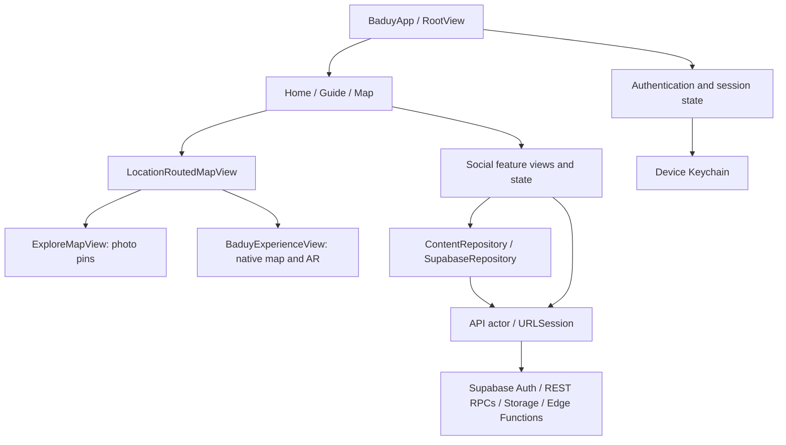

# Architecture

[Back to README](../README.md)

Baduy uses SwiftUI for the app, UIKit/MapKit for clustered map annotations, RealityKit/ARKit for the local experience, and hosted Supabase for authentication, data, media, and custom server operations. The iOS client uses URLSession rather than the Supabase Swift SDK.

## Entry and state

`Baduy/App/BaduyApp.swift` defines the app entry, `RootView`, and `MainTabs`. `AppState` restores the session and controls sign-in, recovery, username completion, and app notices. View-specific observable state handles feed, upload, guides, and other screens.

The project uses Combine `ObservableObject`/`@Published`. `ViewState` is an alias for `SwiftUI.State` to avoid an Xcode macro-name conflict in this build environment; it is not a separate state-management framework.

## Where to make a change

| Concern | File under the repository root |
|---|---|
| App entry and tabs | `Baduy/App/BaduyApp.swift` |
| Auth orchestration and feed state | `Baduy/Social/Features/AppState.swift` |
| HTTP requests, token refresh, signed media URLs | `Baduy/Social/Core/API.swift` |
| Session and PKCE persistence | `Baduy/Social/Core/Keychain.swift` |
| Feed, votes, guides, map queries | `Baduy/Social/Core/Repository.swift` |
| Social feed and post detail UI | `Baduy/Social/Features/FeedView.swift` |
| Upload preparation and Kanekes location picker | `Baduy/Social/Features/UploadView.swift` |
| Guide samples and WhatsApp links | `Baduy/Social/Features/GuideView.swift` |
| Photo pins and clustering | `Baduy/Social/Features/MapView.swift` |
| Location permission, timeout, destination | `Baduy/Social/Features/LocationRoutedMapView.swift` |
| Geographic decision rules | `Baduy/Social/Features/MapAreaPolicy.swift` |
| Polygon and landmark coordinates | `Baduy/Model/MapLandmark.swift` |
| Native map screen | `Baduy/View/Home/HomeView.swift` |
| Native positioning and interactions | `Baduy/View/Home/HomeViewModel.swift` |
| Ngahuma AR | `Baduy/View/Home/NgahumaRoom.swift`, `Baduy/Model/NgahumaScene.swift` |

Naming inherited from integration: **`HomeView` is the social feed**, declared in `FeedView.swift`. **`BaduyExperienceView` is the native map**, declared in `View/Home/HomeView.swift`. Its model is `BaduyHomeViewModel`. `ContentView` is a standalone development wrapper, not the app entry point.

## Authentication

Username/password login calls the `username-login` Edge Function. It resolves the username privately, verifies the password through Supabase Auth, and returns a session. `API` attaches the user's access token to authenticated requests and coordinates refresh. `SecureStore` saves the session in the device Keychain.

Signup/recovery use PKCE. The initiating device stores a verifier and handles `baduy://auth/confirmation` or `baduy://auth/recovery`. The callback code is exchanged for a session; recovery then presents the new-password screen. Opening the link on another device cannot complete that verifier-bound flow. Baduy and sosmedPOC have separate callback schemes and Keychain storage, but share backend users.

## Content and media

The upload screen prepares media and uploads it to private Storage, then calls `publish_post` to create metadata atomically after checking object ownership. Coordinates are optional and rounded to two decimals. New posts are `pending`; editing a caption returns a post to review. Approved content is queried through `feed_page` or `map_posts`; temporary signed URLs allow authorized media display. Feed pagination uses date/ID cursors. Votes update optimistically and roll back on failure.

`ContentRepository` abstracts the core content operations for tests. Some authentication, upload, and account operations call `API` directly. This is a practical feature/state architecture, not a fully isolated domain layer.

## Location routing

Entering the Map tab or returning to the foreground starts a new check. A usable fix is compared with `MapLandmark.baduyRegion`, an **illustrative polygon, not an official administrative boundary**. Accuracy must be 250 m or better, the fix must be recent, and its accuracy circle must not cross the boundary (minimum 20 m margin).

An inside result opens native Baduy; an outside result opens the photo map. Denied access, errors, or a 12-second authorized-location timeout fall back to the photo map. Routing stops after choosing a destination; it does not switch scenes continuously while the user is in AR. Leaving Map/backgrounding stops routing updates. The native experience manages its own foreground positioning.

The upload picker is separate: its rectangular browsing window helps users select an approximate area and does not decide which Map-tab experience opens.
